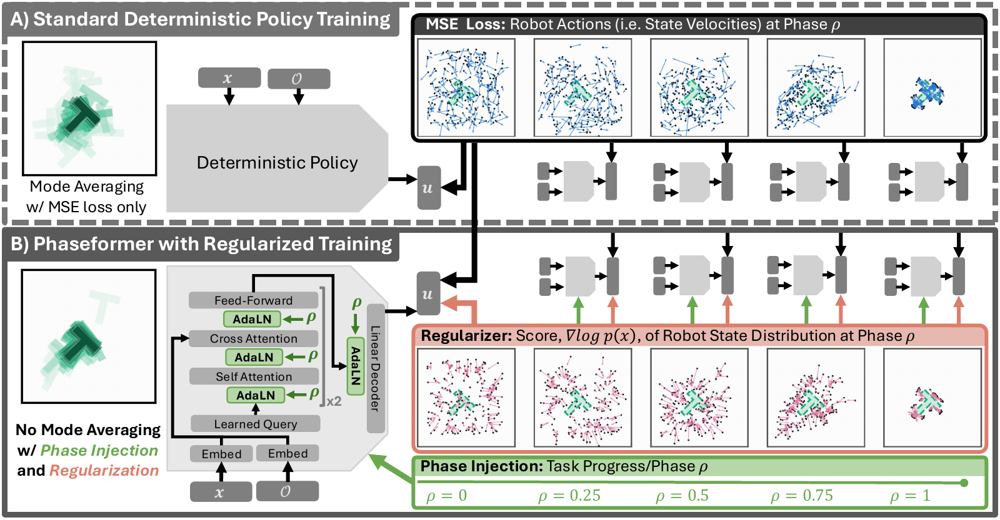

# Phaseformer: Minimum Requirements for Multimodal Behavior Cloning

**Joseph C. Liechty**<sup>1</sup>, **Tucker Hermans**<sup>1,2</sup><br>
<sup>1</sup>University of Utah, <sup>2</sup>NVIDIA

[Project page](https://joeliechty.github.io/phaseformer_site/) ·
[Paper (PDF)](https://joeliechty.github.io/phaseformer_site/static/phaseformer.pdf) ·
[Citation](#citation)



Deterministic behavior cloning policies average the modes of multimodal demonstrations. The
accepted remedies sample stochastic latent inputs during training, often combined with iterative
computation, yet at inference many of them run deterministically. We ask what a deterministic
policy minimally needs. **Phaseformer**, a lightweight transformer that injects task progress
(phase) through adaptive layer norms (AdaLN), and a phase-conditioned MLP use no latent variable,
sampling or iterative computation: one forward pass per control step. They are Pareto-optimal for
ultra-low-latency CPU control, and in navigation, varied demonstration starts restore success
where identical starts fail in every seed.

This repository has the code, the data recipes, and the commands behind every number and figure
in the paper.

## The idea

Reading flow matching as phase-conditioned behavior cloning on straight-line demonstrations, the
paper asks which of flow matching's properties survive on real demonstrations. A deterministic
policy needs:

1. **Inputs that vary before each decision.** A deterministic policy can send two rollouts to
   different modes only if their inputs differ before the split; at a shared input the regression
   target is the branch average. Phaseformer takes this variation from the demonstrated start
   states rather than synthesizing it.
2. **A clock.** Conditioning on task progress `ρ ∈ [0, 1]` removes the temporal aliasing in the
   regression target wherever states are revisited. At run time `ρ` comes from a linear clock or a
   monotone task-progress estimator, clamped at 1. It is never sampled.
3. **Optionally, a sharpener.** Where demonstrations overlap, an L1 penalty on the velocity error
   along the score of the demonstrated states at that phase moves predictions from the average
   demonstrated velocity toward the median one, i.e. toward the locally dominant branch.

The training objective is

```math
\phi^\ast=\arg\min_\phi\ \mathbb{E}\Big[\big\|\pi_\phi(\mathbf{x},\mathcal{O},\rho)-\mathbf{u}\big\|^2+\lambda\,\big|\big(\mathbf{u}-\pi_\phi(\mathbf{x},\mathcal{O},\rho)\big)\cdot\nabla_{\mathbf{x}}\log\hat p_\rho(\mathbf{x})\big|\Big]
```

where `u` is the demonstrated action (a robot-state derivative), `x` the robot state, `O` the
observation and `p̂_ρ` a Gaussian kernel density estimate of the demonstrated robot states at phase
`ρ`. The score is computed in closed form once, before training, and is not used at inference.

Where each policy's stochasticity enters (settings as published):

| policy | stochasticity in training | at test time | clock | feedback |
|---|---|---|---|---|
| Diffusion Policy | noised action chunks | samples noise; *K* passes | denoising step | every *T<sub>a</sub>* steps |
| MIP | noised input to 2nd step | deterministic; 2 passes | step index | every chunk |
| ACT | CVAE latent *z* | *z* = 0; 1 pass | none | every step (ensembling) |
| Streaming Flow Policy | tubes around demos (σ<sub>0</sub>) | σ<sub>0</sub> = 0; 1 pass per action | time in chunk | every chunk |
| **Phaseformer** | **demonstrated starts** | **deterministic; 1 pass** | **task progress ρ** | **every step** |

## Tasks

| task | demonstrations | what varies |
|---|---|---|
| **Skate navigation**: a nonholonomic SE(2) robot, three obstacle scenarios: **A** single path, **B** dual goal, **C** dual path | 1024 per scenario, generated by a trajectory optimizer ([skate_planner/](skate_planner/)); an independent 1024 held out | 10 seeds at n = 1024; point-to-point versions of C whose training sets differ in one factor each |
| **Push-T** (Chi et al., 2023): push a T block onto a goal pose | the 206 released human demonstrations, 90/10 train/validation split | backbone family (MLP, Phaseformer) and size (0.8M–3.6M parameters), 10 seeds, closed-loop rollouts in `gym-pusht`, latency on CPU and GPU |

The baselines are Diffusion Policy, MIP ("Much Ado About Noising") and ACT, each ported with its
own paper's optimizer, batch size and EMA.

> **Names in the code.** The Python package is `fm_bc` (flow-matching behavior cloning), the
> project's working name. Phaseformer is the Push-T transformer backbone: `PushTTransformer` and
> its sized variants in [fm_bc/pusht/policy.py](fm_bc/pusht/policy.py), built on `PhaseTransformer`
> in [fm_bc/nets/transformer.py](fm_bc/nets/transformer.py). Figures and run directories call it
> **TF**.

## Installation

```bash
git clone https://github.com/joeliechty/phaseformer.git
cd phaseformer
conda env create -f environment.yml
conda activate fm_bc
pip install -e '.[dev,pusht,pusht-sim]'     # zarr for the Push-T conversion, gym-pusht for rollouts
PYTHONNOUSERSITE=1 pytest tests -q          # 295 tests, about two minutes on CPU
```

- **Python 3.10** is required: `theseus-ai` 0.2.3, which the skate planner uses, ships wheels only up to cp310.
- **numpy < 2**, because torch 2.1.2 predates the NumPy 2 ABI.
- `PYTHONNOUSERSITE=1` keeps packages from `~/.local` out of the env. Without it, a stray pytest
  plugin there can break test collection.
- The Push-T code and its tests need only torch. They don't import Theseus.

## Data

Neither dataset is committed (`data/` is git-ignored).

```bash
# Skate: rebuild the shipped demos bit for bit and check them against scripts/skate/nav_datasets.sha256.json
python scripts/skate/reproduce_datasets.py --out data
python scripts/skate/reproduce_datasets.py --check data          # verify an existing copy

# Push-T: download the released demos (~30 MB, SHA-256 checked), convert, and build the 90/10 split
bash   scripts/pusht/download_pusht.sh
python scripts/pusht/convert_pusht.py
python scripts/pusht/prepare_pusht.py --split ratio --fractions 0.9 0.1 0.0 --seed 42 \
    --n-grid 128 --normalizer minmax --out data/pusht/pusht_prepared_9010.npz
python scripts/pusht/inspect_pusht.py --data data/pusht/pusht_prepared_9010.npz   # audit; non-zero exit on failure
```

`scripts/skate/generate_datasets.py` followed by `compute_divergence.py` makes *new* skate datasets
with the current planner. `reproduce_datasets.py` is the one that matches scenarios A/B/C
([docs/SKATE.md](docs/SKATE.md) explains why). The point-to-point sets are generated by
`run_deterministic_grid.sh` (below).

## Paper → code

| concept | where |
|---|---|
| SE(2) log / exp, pairwise body twists | [fm_bc/se2.py](fm_bc/se2.py) |
| kNN divergence of the demos, kernel score `∇log p_ρ` | [fm_bc/divergence.py](fm_bc/divergence.py) (validated on flows of known divergence: [fm_bc/benchmarks.py](fm_bc/benchmarks.py)) |
| **Skate** policy network and its SE(2) divergence | [fm_bc/skate/policy.py](fm_bc/skate/policy.py) |
| FM loss, score / divergence / CDM regularizers, λ schedule, training loop | [fm_bc/skate/training.py](fm_bc/skate/training.py) |
| scenarios A/B/C, the point-to-point sets, and their start and goal distributions | [fm_bc/skate/scenarios.py](fm_bc/skate/scenarios.py) |
| demo generation, rejection, divergence and score targets | [fm_bc/skate/dataset.py](fm_bc/skate/dataset.py), planner in [skate_planner/](skate_planner/) |
| rollouts, MMD, collisions, success, mode split | [fm_bc/skate/evaluation.py](fm_bc/skate/evaluation.py) |
| point-to-point dual path: what makes a deterministic policy split | [scripts/skate/run_deterministic_grid.sh](scripts/skate/run_deterministic_grid.sh), [scripts/skate/evaluate_fixed_start.py](scripts/skate/evaluate_fixed_start.py) |
| **Push-T** policy (MLP and Phaseformer at every size, with and without phase), agent score | [fm_bc/pusht/policy.py](fm_bc/pusht/policy.py), [fm_bc/pusht/policy_training.py](fm_bc/pusht/policy_training.py) |
| Phaseformer's AdaLN transformer (phase embedding, AdaLN self- and cross-attention blocks) | [fm_bc/nets/transformer.py](fm_bc/nets/transformer.py) |
| Push-T phase grid (geodesic resampling, per-episode `dt`) | [fm_bc/pusht/grid.py](fm_bc/pusht/grid.py), [fm_bc/pusht/prepared.py](fm_bc/pusht/prepared.py) |
| Push-T rollout clock (monotone task-progress estimator, MLP and transformer) | [fm_bc/pusht/phase_mlp.py](fm_bc/pusht/phase_mlp.py) |
| Push-T closed-loop rollouts, MMD | [fm_bc/pusht/sim.py](fm_bc/pusht/sim.py), [fm_bc/pusht/evaluation.py](fm_bc/pusht/evaluation.py) |
| Push-T scale study: every backbone × clock, scored over seeds | [scripts/pusht/compare_tf_scale.py](scripts/pusht/compare_tf_scale.py) |
| Push-T latency of every backbone × clock and the baselines (CPU, GPU, CUDA graph) | [scripts/pusht/benchmark_pusht_inference_grid.py](scripts/pusht/benchmark_pusht_inference_grid.py) |
| Push-T Pareto front | [scripts/pusht/plot_pusht_pareto.py](scripts/pusht/plot_pusht_pareto.py) |
| Push-T phase variants held at ρ = 1 (`--hold-at-rho1`) | [scripts/pusht/plot_pusht.py](scripts/pusht/plot_pusht.py) |
| baselines: losses and samplers | [fm_bc/skate/baselines.py](fm_bc/skate/baselines.py), [fm_bc/pusht/baselines.py](fm_bc/pusht/baselines.py) |
| baseline networks (DP 1D UNet, MIP residual MLP, ACT CVAE transformer) | [fm_bc/nets/](fm_bc/nets/) |
| Lean 4 formalization of the appendix proofs | [lean/](lean/) |

### Method names

Figures use the network's name; run directories use the loss. The paper's four policy variants
are a 2×2 of *phase input* × *score regularizer*:

| figure label | skate run dir | Push-T run dir |
|---|---|---|
| MLP (no phase, no score) | `mlp` | `mlp` |
| MLP+score | `mlp_score_w0.5` | `mlp_score_w2.5_const` |
| MLP+phase | `fm` | `fm` |
| **MLP+phase+score** | `score_w0.5` | `score_w2.5_const` |
| Diffusion Policy / MIP / ACT | `dp`, `mip`, `act` (`*_te0.01`: closed loop with temporal ensembling) | `dp`, `mip`, `act` |

`w0.5` / `w2.5` is λ, and `const` (Push-T) or no suffix (skate) means λ is held constant. Arms named
`*_cos0.5` anneal λ to 0 over the first half of training, and `cdm_*` / `div_*` are the regularizer
ablation. The TF variants (Phaseformer) are named the same way, with "TF" in place of "MLP".

Each Push-T backbone appends a suffix to the run directory (`--arch` in `train_pusht_policy.py`).
The phase variants of each Pareto model run on their own rollout clock:

| model | `--arch` | run suffix | shape | parameters | clock in the Pareto figure |
|---|---|---|---|---|---|
| MLP small | `mlp` | (none) | 4 × 512 | 0.8M | MLP small, 2 × 512 (`runs/pusht/phase_start`) |
| MLP-med wide | `mlp_medium` | `_mlpmed` | 4 × 768 | 1.8M | MLP med deep, 3 × 512 (`runs/pusht/phase_start_d3`) |
| MLP-med deep | `mlp_medium_deep` | `_mlpdeep` | 8 × 512 | 1.8M | (scale study only) |
| MLP-large | `mlp_large` | `_mlplarge` | 7 × 768 | 3.6M | (scale study only) |
| TF | `transformer` | `_tf` | hidden 128, 2 blocks | 0.9M | (scale study only) |
| TF-med wide | `transformer_medium` | `_tfmed` | hidden 180, 2 blocks | 1.8M | MLP large, 3 × 724 (`runs/pusht/phase_start_w724_d3`) |
| TF-med deep | `transformer_medium_deep` | `_tfdeep` | hidden 128, 4 blocks | 1.7M | (scale study only) |
| TF-large | `transformer_large` | `_tflarge` | hidden 180, 4 blocks | 3.4M | MLP large, 3 × 724 (`runs/pusht/phase_start_w724_d3`) |

The paper's Push-T violins, final poses and rollouts use the two parameter-matched 1.8M models,
MLP-med wide and TF-med wide. Their phase variants are **held at ρ = 1**: each episode is scored
where the policy's clock first reads 1, the point at which a phase-conditioned policy has finished
its task.

The point-to-point datasets have different names in the paper and in the code:

| paper | `--scenario` | label in the repository's figures |
|---|---|---|
| point-to-point fixed | `dual_path_fixed` | fixed |
| +path noise | `dual_path_fixed_via` | +via |
| +start noise | `dual_path_noisy_start` | +start |
| dual path | `dual_path` (scenario C) | C |

## Reproducing the results

All training needs a GPU. Each script skips runs that already have a `metrics.json`, so an
interrupted grid resumes where it stopped. Runs go to `runs/` and results to `output/`; both are
git-ignored.

**Skate navigation** (3 scenarios × 10 seeds; 20k steps per MLP run, 100k per baseline run):

```bash
S="0 1 2 3 4 5 6 7 8 9"
python scripts/skate/run_experiments.py --cdm-weights 0 --n-train 1024 --seeds $S                 # MLP+phase
python scripts/skate/run_experiments.py --cdm-weights 0 --no-phase --n-train 1024 --seeds $S      # MLP
python scripts/skate/run_experiments.py --cdm-weights 0.5 --cdm-terms score --cdm-schedule constant \
    --n-train 1024 --seeds $S                                                                     # MLP+phase+score
python scripts/skate/run_experiments.py --cdm-weights 0.5 --cdm-terms score --cdm-schedule constant \
    --no-phase --n-train 1024 --seeds $S                                                          # MLP+score
python scripts/skate/train_baselines.py --methods dp mip act --n-train 1024 --seeds $S
python scripts/skate/evaluate_temporal_ensemble.py --methods dp mip act --scenarios all \
    --n-train 1024 --seeds $S --m 0.01                                                            # closed-loop baselines
python scripts/skate/benchmark_inference.py --runs runs --out output/skate/policy                # timing table
python scripts/skate/evaluate_policies.py --runs runs --test data/test --out output/skate/policy  # tables + figures
```

The CDM ablation is
`--cdm-weights 0.05 --cdm-terms both div score --cdm-schedule cosine --cdm-anneal-frac 0.5`.

**Point-to-point dual path.** This builds the three one-factor training sets, trains the four MLP
variants on each (10 seeds, n = 1024) and writes `output/skate_deterministic/`. Scenario C's runs
come from the grid above. Run it with the `fm_bc` env active, or point `PYTHON` at its interpreter.

```bash
bash scripts/skate/run_deterministic_grid.sh
```

**Push-T, the small backbones** (MLP small and TF; 8 policy arms, DP, MIP, ACT, 10 seeds each; 500 epochs):

```bash
S="0 1 2 3 4 5 6 7 8 9"
for A in mlp transformer; do
  python scripts/pusht/train_pusht_policy.py --arch $A --methods mlp fm --seeds $S
  python scripts/pusht/train_pusht_policy.py --arch $A --methods mlp_score score \
      --score-weights 2.5 --score-anneal-fracs 0 --seeds $S
done
python scripts/pusht/train_pusht_baselines.py --methods dp mip act --seeds $S \
    --prepared data/pusht/pusht_prepared_9010.npz
# rollout clock: a phase estimator per seed, from the start pose
python scripts/pusht/train_pusht_phase.py --use-start --seeds $S \
    --prepared data/pusht/pusht_prepared_9010.npz --out runs/pusht/phase_start
python scripts/pusht/rollout_pusht_policy.py --runs runs/pusht/policy \
    --prepared data/pusht/pusht_prepared_9010.npz \
    --methods mlp fm mlp_score_w2.5_const score_w2.5_const \
              mlp_tf fm_tf mlp_score_w2.5_const_tf score_w2.5_const_tf \
    --clock phase_mlp --phase-runs runs/pusht/phase_start \
    --phase-eps 0.004081632653061225 --phase-fixed-step --tag-suffix _start_fixedstep_e1o245
python scripts/pusht/rollout_pusht_baselines.py --runs runs/pusht/policy --loop open
python scripts/pusht/rollout_pusht_baselines.py --runs runs/pusht/policy --loop closed --m 0.01
python scripts/pusht/benchmark_pusht_inference.py --runs runs/pusht/policy --out output/pusht_9010
python scripts/pusht/summarize_pusht_policy.py --runs runs/pusht/policy --out output/pusht_9010/SUMMARY.md
```

**Push-T, the Pareto models** (MLP-med wide, TF-med wide, TF-large and their clocks; the same
recipe and seeds):

```bash
S="0 1 2 3 4 5 6 7 8 9"
for A in mlp_medium transformer_medium transformer_large; do
  python scripts/pusht/train_pusht_policy.py --arch $A --methods mlp fm --seeds $S
  python scripts/pusht/train_pusht_policy.py --arch $A --methods mlp_score score \
      --score-weights 2.5 --score-anneal-fracs 0 --seeds $S
done
# the two larger clocks: MLP med deep (3 x 512) and MLP large (3 x 724)
python scripts/pusht/train_pusht_phase.py --use-start --hidden 512 512 512 --seeds $S \
    --prepared data/pusht/pusht_prepared_9010.npz --out runs/pusht/phase_start_d3
python scripts/pusht/train_pusht_phase.py --use-start --hidden 724 724 724 --seeds $S \
    --prepared data/pusht/pusht_prepared_9010.npz --out runs/pusht/phase_start_w724_d3

R="python scripts/pusht/rollout_pusht_policy.py --runs runs/pusht/policy \
   --prepared data/pusht/pusht_prepared_9010.npz --clock phase_mlp \
   --phase-eps 0.004081632653061225 --phase-fixed-step"
# every arm on the small models' clock (the phase-free arms ignore the clock at a fixed step)
for B in _mlpmed _tfmed _tflarge; do
  $R --methods mlp$B fm$B mlp_score_w2.5_const$B score_w2.5_const$B \
     --phase-runs runs/pusht/phase_start --tag-suffix _start_fixedstep_e1o245
done
# the phase arms on their own clock
$R --methods fm_mlpmed score_w2.5_const_mlpmed \
   --phase-runs runs/pusht/phase_start_d3 --tag-suffix _startd3_fixedstep_e1o245
$R --methods fm_tfmed score_w2.5_const_tfmed fm_tflarge score_w2.5_const_tflarge \
   --phase-runs runs/pusht/phase_start_w724_d3 --tag-suffix _startw724d3_fixedstep_e1o245

python scripts/pusht/compare_tf_scale.py --runs runs/pusht/policy --out output/pusht_9010/tf_scale
python scripts/pusht/compare_tf_scale.py --family mlp --runs runs/pusht/policy --out output/pusht_9010/mlp_scale
python scripts/pusht/benchmark_pusht_inference_grid.py --out output/pusht_9010/inference_grid.csv
```

The full scale study also trains `mlp_medium_deep`, `mlp_large` and `transformer_medium_deep`
and the other six clocks; `compare_tf_scale.py`'s docstring and
[fm_bc/pusht/STATUS.md](fm_bc/pusht/STATUS.md) list them.

Rollouts follow Diffusion Policy's protocol: 50 environments (seeds 100000–100049), at most 300
steps each. **score** is the episode's maximum of `clip(coverage / 0.95, 0, 1)`. Holding the phase
variants at ρ = 1 is done when the figures are drawn (`plot_pusht.py --hold-at-rho1`): it truncates
each stored episode where its clock first reads 1, so no extra rollouts are needed.

**Figures.** Each command below reads finished runs and writes PNG and PDF figures, and the
rollout GIFs, into `output/`:

```bash
python scripts/skate/plot_divergence.py --data data --out output/skate/divergence
for SC in single_path dual_goal dual_path; do                          # the phase-evolution GIFs
  python scripts/skate/animate_phase_evolution.py --scenario $SC --out output/skate/divergence
done
python scripts/skate/paper_divergence_figures.py --data data --out output/skate/paper --device cuda
python scripts/skate/plot_score_cost.py --out output/skate/paper
python scripts/skate/evaluate_policies.py --runs runs --test data/test --out output/skate/policy
python scripts/skate/evaluate_fixed_start.py
python scripts/pusht/plot_pusht.py --only data --prepared data/pusht/pusht_prepared_9010.npz \
    --out output/pusht_9010/figures
python scripts/pusht/plot_pusht_pareto.py
python scripts/pusht/plot_pusht.py --only pareto --hold-at-rho1       # Pareto violins and final poses at rho = 1
python scripts/pusht/plot_pusht.py --only gifs                         # baseline and small-backbone GIFs
python scripts/pusht/plot_pusht.py --only pareto_gifs                  # Pareto models, phase-free arms
python scripts/pusht/plot_pusht.py --only pareto_gifs --hold-at-rho1   # Pareto models, phase arms at rho = 1
python scripts/combined/plot_training_curves.py
```

## Where the paper's figures come from

`output/` is not committed. The paper's main figures and the Push-T rollout GIFs are on the
[project page](https://joeliechty.github.io/phaseformer_site/). To regenerate them, run the
commands above; each figure is written as both `.png` and `.pdf`.

| paper figure | drawn by | written to |
|---|---|---|
| overview (phase injection and the score regularizer) | by hand | [assets/overview.png](assets/overview.png) |
| dual-goal phase evolution | `scripts/skate/plot_divergence.py` | `output/skate/divergence/dual_goal_phase_evolution` |
| navigation rollouts, scenarios A/B/C | `scripts/skate/evaluate_policies.py` | `output/skate/policy/fig_policy_rollouts_n1024_ABC` |
| Push-T violins of the 1.8M models at ρ = 1 (score, position and orientation error, success) | `scripts/pusht/plot_pusht.py --only pareto --hold-at-rho1` | `output/pusht_9010/figures/fig_pusht_violin_pareto_score_goal_rho1` |
| Push-T final poses at ρ = 1 | `scripts/pusht/plot_pusht.py --only pareto --hold-at-rho1` | `output/pusht_9010/figures/fig_pusht_final_poses_pareto_rho1` |
| point-to-point dual path: start spread vs path variation | `scripts/skate/evaluate_fixed_start.py` | `output/skate_deterministic/fig_p2p_violin` |
| Push-T Pareto front, score against latency (CPU and GPU) | `scripts/pusht/plot_pusht_pareto.py` | `output/pusht_9010/figures/fig_pusht_pareto` |
| appendix: closed-form rerouting example | not generated by this repository | — |
| appendix: cost of the kernel score, SE(2) vs SE(3) | `scripts/skate/plot_score_cost.py` | `output/skate/paper/fig_score_cost` |
| appendix: skate violins, regularizer ablation | `scripts/skate/evaluate_policies.py` | `output/skate/policy/fig_policy_violin_n1024_ablation` |
| appendix: divergence / score fields of the three scenarios | `scripts/skate/plot_divergence.py` | `output/skate/divergence/overview_fields` |
| appendix: Push-T velocity and score field | `scripts/pusht/plot_pusht.py --only data` | `output/pusht_9010/figures/fig_pusht_velocity_score` |
| appendix: kNN divergence bias | `scripts/skate/paper_divergence_figures.py` | `output/skate/paper/fig_div_bias` |
| appendix: divergence on the datasets | `scripts/skate/paper_divergence_figures.py` | `output/skate/paper/fig_div_datasets` |
| appendix: skate training curves | `scripts/combined/plot_training_curves.py` | `output/skate/policy/fig_policy_training_curves_n1024` |
| appendix: Push-T training curves of the Pareto models | `scripts/combined/plot_training_curves.py` | `output/pusht_9010/figures/fig_pusht_training_curves_pareto` |
| appendix: skate violins, all arms and baselines | `scripts/skate/evaluate_policies.py` | `output/skate/policy/fig_policy_violin_n1024` |

The paper's versions of the two Push-T and point-to-point violin figures, and of the two skate
violin figures, were relabelled for print after export. The scripts draw the same data with the
repository's own labels.

The scripts also write the tables behind the figures, with every metric, arm and significance test:

- **Skate:** `output/skate/policy/SUMMARY.md`, which also covers the regularizer ablation and the inference cost, and the LaTeX tables `table_policy*.tex`.
- **Point-to-point dual path:** `output/skate_deterministic/SUMMARY.md`.
- **Push-T:** `output/pusht_9010/SUMMARY.md` (the small backbones, clock variants, baselines and checkpoint selection), the scale study in `output/pusht_9010/tf_scale/SUMMARY.md` and `output/pusht_9010/mlp_scale/SUMMARY.md`, and the latencies in `output/pusht_9010/inference_grid.csv`.

## Notes on the experiments

- **Seeds at n = 1024.** Each skate training file holds exactly 1024 demos, so at n = 1024 every seed
  trains on the same demos. The seeds differ only in initialization and minibatch order.
- **Not bit-reproducible.** GPU training isn't deterministic, so a retrained run matches the
  reported one only in distribution. The *data* is reproducible: the skate demos rebuild bit for bit,
  and the Push-T split is seeded.
- **Push-T model selection.** Each run's `best.pt` is the EMA model at the lowest loss on the 21
  validation episodes. The closed-loop rollouts, in fresh `gym-pusht` environments, are the test.
  The phase estimators behind the rollout clock are fit on all 206 demos. They are a clock, not a
  learned result.
- **Clocks of the Pareto models.** MLP-med wide, TF-med wide and TF-large each run on the MLP
  clock that the scale study scored best for that backbone's phase+score variant; MLP small keeps
  the original clock. Each choice is one of several close configurations, within seed noise of its
  neighbours, and the scale-study summaries give every combination.
- **ACT is deterministic.** Its latent is fixed to the prior mean at inference, so it cannot split
  between modes. Zero within-start diversity is expected, not a bug.
- **MeanFlow** (`fm_bc/skate/baselines.py`) is implemented and tested but is not reported: its
  one-step chunks were too noisy to reach the goal.
- **Timings** come from a single machine: RTX 4090, Ryzen 7 5700X (8 threads), torch 2.1.2 + cu121.
  Latency is the median per control step at batch 1; a phase variant is timed with its clock.

## Lean proofs

[lean/](lean/) formalizes the appendix proofs in Lean 4 with Mathlib: no `sorry`, no `admit`, no new
axioms. `lean/verify.sh` builds it and checks the axiom audit (`lean/audit.out` is the committed
output). Statement numbers follow the appendix draft the formalization was written against;
[lean/README.md](lean/README.md) maps each Lean theorem to its statement.

## Repository layout

```
fm_bc/            the method
  se2.py, divergence.py, benchmarks.py, windows.py     shared by both tasks
  nets/           backbones: Phaseformer's AdaLN transformer, DP 1D UNet, MIP residual MLP, ACT
  skate/          skate navigation: scenarios, dataset, policy, training, baselines, evaluation, plots
  pusht/          Push-T: data, splits, phase grid, policy, baselines, phase clock, simulator, evaluation
skate_planner/    Theseus trajectory optimizer that generates the skate demonstrations
scripts/
  skate/          dataset rebuild, training grids, evaluation, paper figures
  pusht/          download / convert / prepare, training, rollouts, scale study, latency, figures
  combined/       figures that put both tasks side by side
tests/            unit tests (shared; tests/skate/, tests/pusht/)
examples/skate/   standalone planner demos
lean/             Lean 4 formalization of the appendix proofs
docs/             design notes: PLANNER.md, SKATE.md, PUSHT.md
assets/           the overview figure for this README
data/, runs/, output/   datasets, training runs and results (git-ignored; made by the commands above)
```

## Further reading

- [docs/PLANNER.md](docs/PLANNER.md): the skate model, the factor graph, the solver and its
  diagnostics.
- [docs/SKATE.md](docs/SKATE.md): skate data provenance, the baselines' implementation details,
  and the CDM ablation.
- [docs/PUSHT.md](docs/PUSHT.md): the Push-T data pipeline, phase gridding, the constants that matter,
  and the task-progress CVAE.
- [fm_bc/pusht/STATUS.md](fm_bc/pusht/STATUS.md): the Push-T lab notebook, including the scale
  study and the transformer clocks.

## Citation

```bibtex
@article{liechty2026phaseformer,
  title   = {Phaseformer: Minimum Requirements for Multimodal Behavior Cloning},
  author  = {Liechty, Joseph C. and Hermans, Tucker},
  journal = {arXiv preprint arXiv:XXXX.XXXXX},
  year    = {2026}
}
```

## License

MIT; see [LICENSE](LICENSE).
